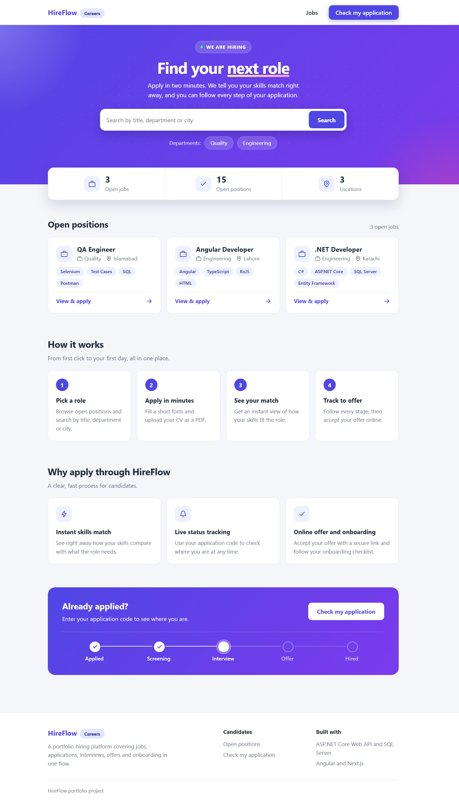
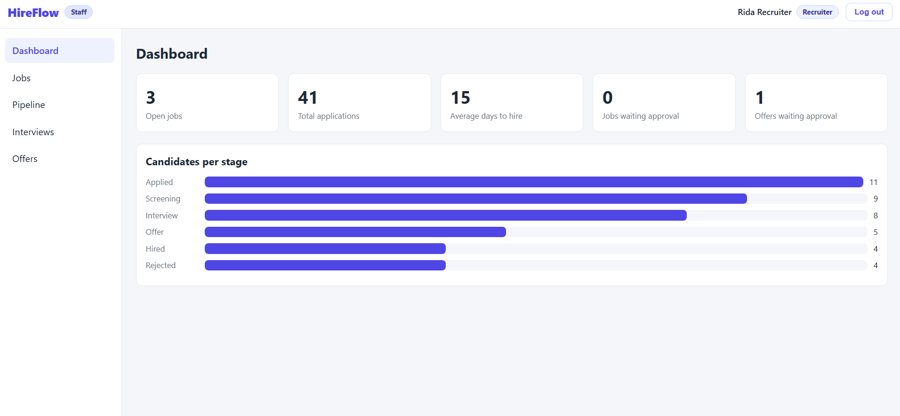
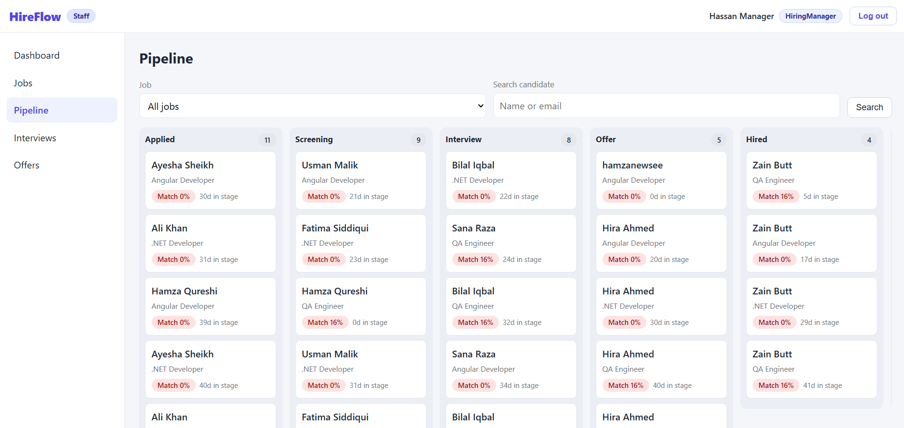

# HireFlow – Hiring & Onboarding Platform (ASP.NET Core Web Api Microservices, SQL Server, Angular,  Next.js)


HireFlow is a hiring and onboarding platform. A company posts a job, candidates apply with a CV, recruiters move them through interview stages, a manager approves the offer, and an accepted offer creates the new hire's onboarding checklist.

I built it to show a complete business flow from the first click to the first day at work, not just a list of pages. It has a public careers site for candidates and a staff app for the hiring team, both talking to one API.

**Live demo**

| | Link |
|---|---|
| Careers site (candidates) | https://hireflow-careers-fawn.vercel.app/ |
| Staff app (hiring team) | https://hireflow-admin-1u8.pages.dev/ |


**Staff demo logins** (password for all three: `Demo@12345`)

| Email | Role |
|---|---|
| recruiter@hireflow.test | Recruiter |
| manager@hireflow.test | Hiring Manager |
| admin@hireflow.test | Admin |

---

## Screenshots


*Careers site: candidates search the open jobs.*


*Applying with a CV. The skills match is worked out as soon as the CV is uploaded.*


*Dashboard: open jobs, applications, average days to hire, and how many candidates are in each stage.*


*Pipeline: drag a candidate from one stage to the next.*


*Candidate profile: CV, match score, interviews, offer, onboarding and the full timeline.*


*Interviews and scorecards.*


*Offers waiting for approval.*

---

## How a hire happens

1. A **recruiter** creates a job. It starts as a draft.
2. The recruiter submits it for approval. A **hiring manager** approves it, and the job goes live on the careers site.
3. A **candidate** finds the job, fills in a short form and uploads a PDF or Word CV. They get an application code.
4. The app reads the CV and gives it a **skills match score** from 0 to 100, based on how many of the job's required skills appear in the CV.
5. The recruiter moves the candidate through **Applied, Screening, Interview, Offer, Hired or Rejected**.
6. The recruiter schedules an interview. The interviewer fills in a **scorecard** (a 1 to 5 rating and feedback).
7. Once a scorecard exists, the candidate can move to **Offer**. The recruiter creates the offer and a manager approves it.
8. The candidate gets a private link, opens it without logging in, and accepts or declines.
9. If they accept, they become **Hired**, an **onboarding checklist** is created, and the job closes automatically when all its positions are filled.

Every important action is saved in an **activity log** (who did what and when), and each candidate has their own timeline.

---

## Who can do what

There are four kinds of users. Candidates never log in. The three staff roles see the same menu, but some buttons only appear for the right role.

| Action | Recruiter | Hiring Manager | Admin |
|---|:---:|:---:|:---:|
| Create, edit and submit jobs | Yes | | Yes |
| Approve a job | | Yes | Yes |
| Close a job | Yes | Yes | Yes |
| Move candidates between stages | Yes | | Yes |
| Schedule or cancel interviews | Yes | | Yes |
| Submit a scorecard | Only for their own interviews | Only for their own interviews | Only for their own interviews |
| Create an offer | Yes | | Yes |
| Approve an offer | | Yes | Yes |
| Tick off onboarding tasks | Yes | | Yes |
| See the activity log | | | Yes |

The idea behind it: the person who prepares a job or an offer is not the one who approves it.

**Candidates** can search jobs, apply, check their application status with their email and code, and answer an offer through their private link. That is all they can see.

---

## The screens

### Careers site (for candidates)

- **Home.** Search the open jobs and filter by department and city.
- **Job details.** Description, required skills and the application form. The CV must be a PDF or Word file up to 5 MB.
- **Check my application.** Enter your email and application code to see which stage you are in. It shows nothing private about other people or about internal notes.
- **Offer page.** A private link for one offer. It shows the job and the salary with Accept and Decline buttons. The link works once.

### Staff app (for the hiring team)

- **Dashboard.** Open jobs, total applications, average days to hire, jobs and offers waiting for approval, and a bar chart of candidates per stage.
- **Jobs.** Create and edit jobs, submit them for approval, approve them and close them. Filter by status and search.
- **Pipeline.** A board with one column per stage. Drag a candidate to move them. If a rule blocks the move (for example, no scorecard yet), the card stays where it was and a message explains why. Rejecting a candidate asks for a reason. On a phone there is a "Move to" menu instead of dragging.
- **Candidate profile.** Contact details, match score, CV download, interviews with scorecards, offer creation, the onboarding checklist for new hires, and the timeline.
- **Interviews.** All interviews in one list, with a button for the interviewer to add a scorecard.
- **Offers.** All offers with their status. Managers approve here, and approved offers have a "Copy candidate link" button.
- **Activity log.** Admin only. Everything that happened, newest first.

---

## Rules the app enforces

These are checked on the server, not just hidden in the screens, and each one has a unit test.

- A job must be approved before it appears on the careers site, and only drafts can be edited.
- Closed jobs do not accept applications. One person can apply to the same job only once.
- A candidate cannot move to Offer until an interview scorecard exists.
- Rejecting a candidate needs a reason. A hired candidate cannot be moved.
- An interviewer cannot be booked for two interviews at the same time. Interviews cannot be moved or cancelled after they start.
- Only the assigned interviewer can submit the scorecard, and only one per interview.
- An offer can only be created for a candidate in the Offer stage, and only managers or admins approve it.
- The offer link works once. Accepting it hires the candidate, creates the onboarding tasks and closes the job when every position is filled.

---

## Built with

| Part | What I used |
|---|---|
| API | ASP.NET Core Web API on .NET 10, C# |
| Data | Entity Framework Core (code first, Fluent API), SQL Server, SQLite for the free demo |
| Login | JWT tokens, role-based access, passwords hashed with the ASP.NET Identity hasher |
| Staff app | Angular (standalone components, lazy-loaded pages) |
| Careers site | Next.js with TypeScript |
| Notifications | A small separate ASP.NET service the API calls over HTTP |
| Tests | xUnit and NSubstitute |
| Delivery | Docker, GitHub Actions, Vercel, Cloudflare Pages |

### How the code is organised

```
src/HireFlow.Domain          entities and enums
src/HireFlow.Application     services (the business rules), DTOs, interfaces
src/HireFlow.Infrastructure  database, repositories, JWT, CV file handling
src/HireFlow.Api             controllers and Program.cs
src/HireFlow.Notifications   the separate notification service
tests/HireFlow.Tests         unit tests for the rules
web-admin                    Angular staff app
web-careers                  Next.js careers site
```

A request goes **Controller, then Service, then Repository**. Controllers only pass data along, services hold the rules, and repositories only talk to the database. Each has an interface, so the rules can be tested without a database. Dependencies point inward: the Domain project knows nothing about the others.

A few choices worth explaining:

- **One API plus one separate service,** not many microservices. For an app this size a single API is the sensible start. The Notifications service shows how a part can be split out, and if it is down the main action still succeeds.
- **Specific repositories** (jobs, candidates, applications and so on) instead of one generic repository, because they are easier to read.
- **The match score is rule-based.** It counts how many required skills appear in the CV text. It is simple and easy to explain, and it sits behind an interface so a smarter model could replace it later.
- **No MediatR, AutoMapper or other paid-licence libraries.** Mapping is written by hand.

---

## Run it on your computer

You need the .NET 10 SDK and Node.js (LTS). The easiest start uses SQLite, so no database install is needed.

**1. API** (http://localhost:5000/swagger)
```
cd src/HireFlow.Api
dotnet run --Database:Provider=Sqlite
```

**2. Staff app** (http://localhost:4200)
```
cd web-admin
npm install
npm start
```

**3. Careers site** (http://localhost:3000)
```
cd web-careers
npm install
npm run dev
```

The first start creates the database and fills it with demo data: three staff users, six jobs and forty candidates spread across the stages.

**To use SQL Server instead** (for example to look at the tables in SSMS), put your connection string in `src/HireFlow.Api/appsettings.json` under `ConnectionStrings:SqlServer` and run `dotnet run` without the SQLite option. The tables are created on first start. `docker compose up` also works if you have Docker.

**Tests**
```
dotnet test
```

---

## Security

- Passwords are hashed and never stored in plain text.
- Login and the public apply form are rate limited.
- CV uploads are checked for file type, size and real file content, and saved under random names outside the public folder.
- The JWT key and database password come from configuration, not from the code.
- The API only accepts calls from the websites listed in its CORS settings.
- The public pages return only the information a candidate should see.

---

## What it does not do yet

- **No real emails.** The Notifications service records messages but does not send them, so the recruiter copies the offer link and sends it by hand.
- **Free hosting sleeps.** The demo server stops when idle, and the demo data may reset when it restarts.
- **No file storage in the cloud.** CVs are saved on the server's disk.

If I kept working on it, the next steps would be sending real emails, calendar invites for interviews, and cloud file storage.
