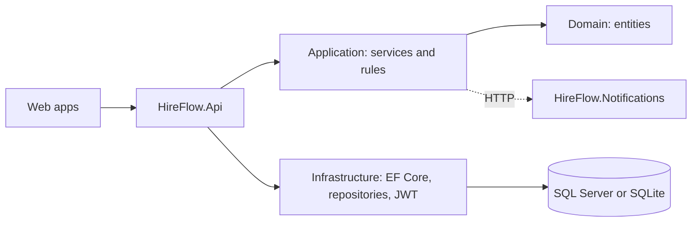

# HireFlow

A hiring and onboarding platform. Companies post jobs, candidates apply with a CV, the system gives a
CV match score, recruiters move candidates through interview stages, and an accepted offer starts the
onboarding checklist.

**What is in this package:** the .NET backend (API, Notifications service, SQL Server or SQLite, unit tests, Docker),
the Angular staff dashboard (`web-admin`) and the Next.js careers site (`web-careers`).
The code was written without a .NET compiler or npm available, so it has not been built yet.
Run the first-run checks below and send me any error text.

## Run it (pick one)

### A) Fastest: SQLite, no database install
```
cd src/HireFlow.Api
dotnet run --launch-profile HireFlow.Api --Database:Provider=Sqlite
```
Swagger opens at http://localhost:5000/swagger. A file `hireflow.db` is created with demo data.

### B) SQL Server 2022 (open it in SSMS)
```
docker compose up -d sqlserver
cd src/HireFlow.Api
dotnet run
```
SSMS: Server `localhost,1433`, Authentication SQL Server, Login `sa`, password from `.env` (`SA_PASSWORD`),
tick **Trust server certificate**. Database name: `HireFlowDb`.
No Docker? Change `ConnectionStrings:SqlServer` in `appsettings.json` to your own SQL Server.

### C) Everything in Docker (API + Notifications + SQL Server)
```
docker compose up --build
```
API at http://localhost:5000/swagger, Notifications at http://localhost:5001/notifications.

### Run the two websites (needs Node.js LTS)
Staff dashboard (Angular), http://localhost:4200:
```
cd web-admin
npm install
npm start
```
Careers site (Next.js), http://localhost:3000:
```
cd web-careers
npm install
npm run dev
```
Both expect the API at http://localhost:5000. To change it: `web-admin/src/environments/environment.ts` and `web-careers/.env.local`.

### In Visual Studio
Open `HireFlow.sln`, set `HireFlow.Api` as startup project, press F5.

## First-run checks
```
dotnet build
dotnet test
```
The project targets .NET 10. For another SDK, change `TargetFramework` in `Directory.Build.props` and the `10.*` package versions in the csproj files.

## Demo logins (password for all: `Demo@12345`)
| Email | Role |
|---|---|
| admin@hireflow.test | Admin |
| recruiter@hireflow.test | Recruiter |
| manager@hireflow.test | HiringManager |

## Try the full flow in Swagger
Or use the websites: log in to the Angular app as recruiter, create and submit a job, approve it as manager, apply on the
Next.js site, then drag the candidate across the Kanban board. The steps below show the same flow in Swagger.

1. `POST /api/auth/login` as recruiter, copy the token, click **Authorize**, paste it.
2. `POST /api/jobs` (creates a Draft), then `POST /api/jobs/{id}/submit`.
3. Log in as manager, authorize, `POST /api/jobs/{id}/approve` (job becomes Open).
4. `POST /api/public/jobs/{id}/apply` with a small PDF (no login). Note the application code.
5. As recruiter: `POST /api/interviews` (schedule), then as the interviewer submit `POST /api/interviews/{id}/scorecard`.
6. `POST /api/applications/{id}/move` to `Offer`, then `POST /api/offers`.
7. As manager: `POST /api/offers/{id}/approve`. Copy `acceptToken`.
8. `POST /api/public/offers/{token}/respond` with `{ "accept": true }`. Candidate is Hired, 4 onboarding tasks appear at `GET /api/onboarding/{applicationId}`, and the job closes when all positions are filled.

## Architecture


```
src/HireFlow.Domain          entities and enums
src/HireFlow.Application     DTOs, interfaces, services (business rules), mappers
src/HireFlow.Infrastructure  DbContext, Fluent API configs, repositories, seeder, JWT, CV storage
src/HireFlow.Api             controllers, middleware, Program.cs
src/HireFlow.Notifications   small separate service (POST /notify)
tests/HireFlow.Tests         xUnit + NSubstitute unit tests
web-admin/                   Angular staff app: login, dashboard, jobs, Kanban pipeline, candidate profile, interviews, offers, activity log
web-careers/                 Next.js public site: job list, job details, apply with CV, application status, offer accept/decline
```
Flow: **Controller (thin) -> Service (rules) -> Repository (database only)**. Dependencies point inward.

## Design decisions
- **Controller-Service-Repository with interfaces:** rules are testable without a database.
- **Specific repositories, not one generic one:** EF Core's DbContext is already a generic repository.
- **Modular monolith plus one separate service:** simplest thing that works; Notifications shows service boundaries.
  A message broker could replace the HTTP call later.
- **SQLite option:** lets a free host run the app without a paid SQL Server.
- **Rule-based match score:** simple, explainable, free; behind `IMatchScoreCalculator` so an AI model can replace it.
- **No MediatR, AutoMapper, MassTransit, FluentAssertions, Moq** (commercial licences). Mapping is written by hand in `Mappers/`.

## Security
JWT with roles, password hashing (ASP.NET Identity hasher), rate limiting on login and apply, CORS from config,
security headers, CV type/size/content checks with random file names outside the web root, no secrets in code
(the JWT key comes from configuration; the SA password in `appsettings.json` is a local development default).

## Migrations (optional)
By default tables are created from the model. To use EF migrations on SQL Server:
```
dotnet tool install --global dotnet-ef
dotnet ef migrations add InitialCreate --project src/HireFlow.Infrastructure --startup-project src/HireFlow.Api --output-dir Data/Migrations
```
Run this before the first start, or drop the database first.

## Not included
Live hosting (see docs/DEPLOY.md), FluentValidation (DataAnnotations are used), real email sending (SMTP), Kubernetes, Azure/AWS.
